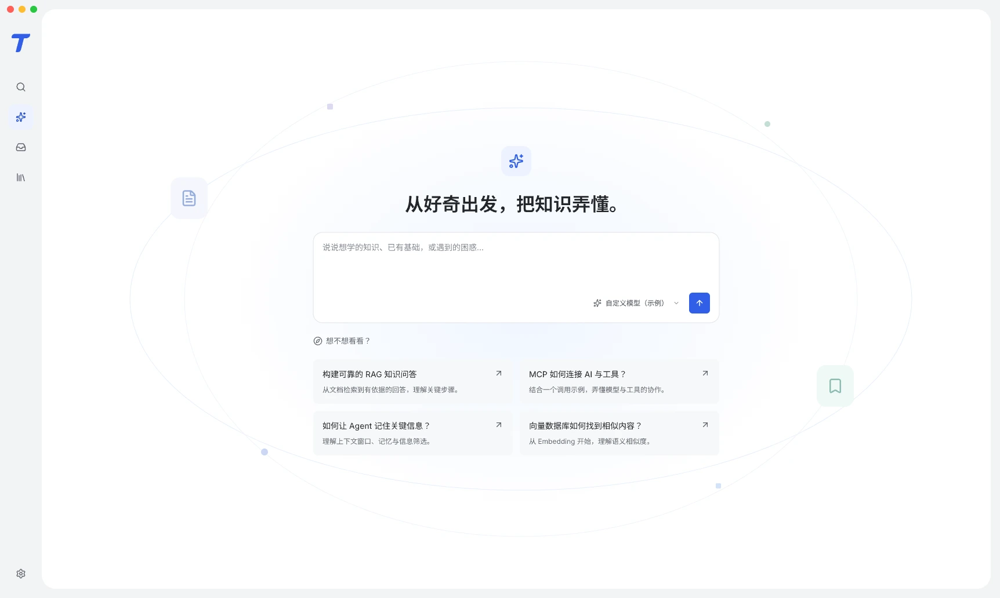
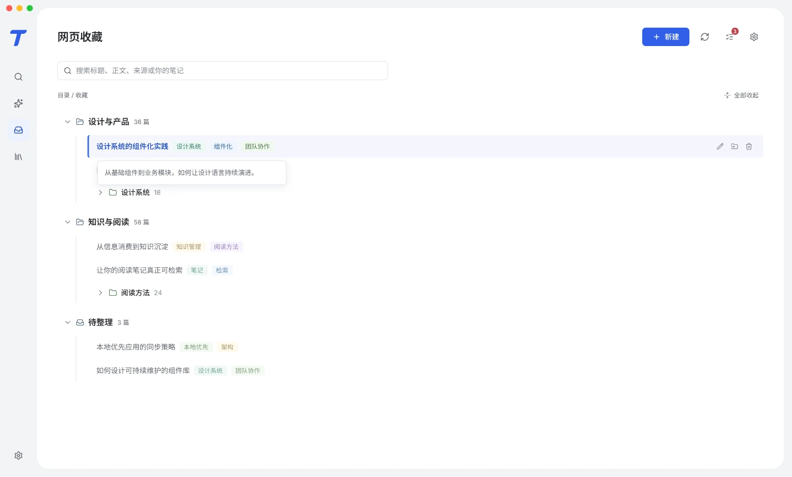
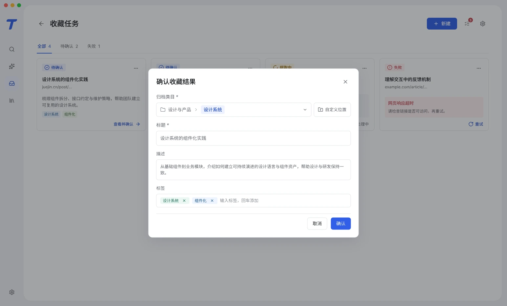
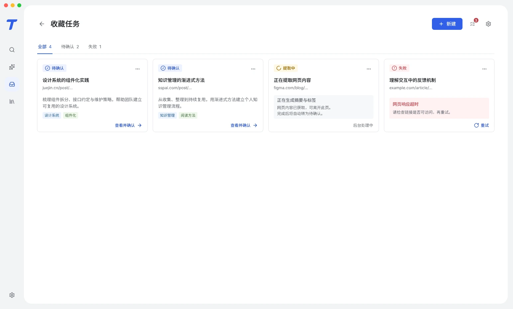
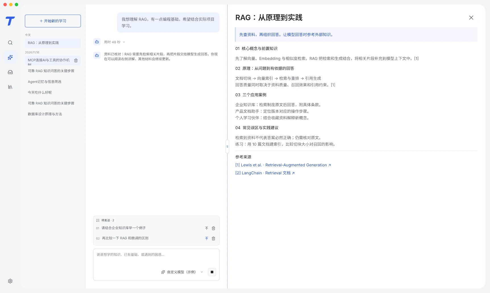
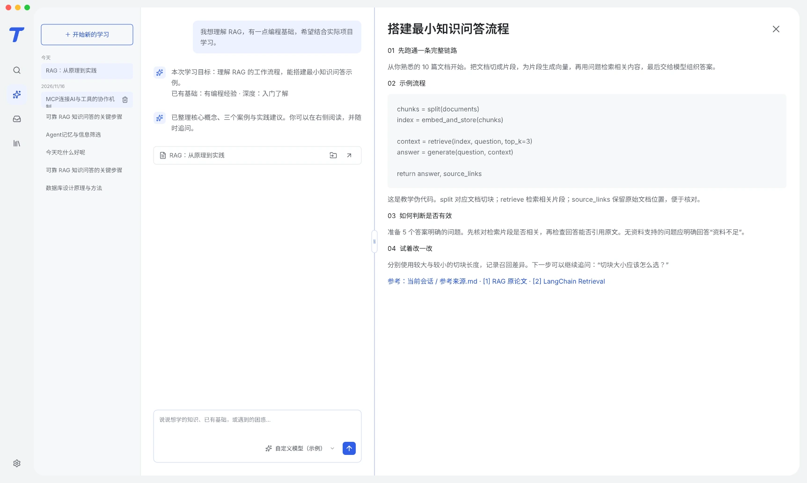
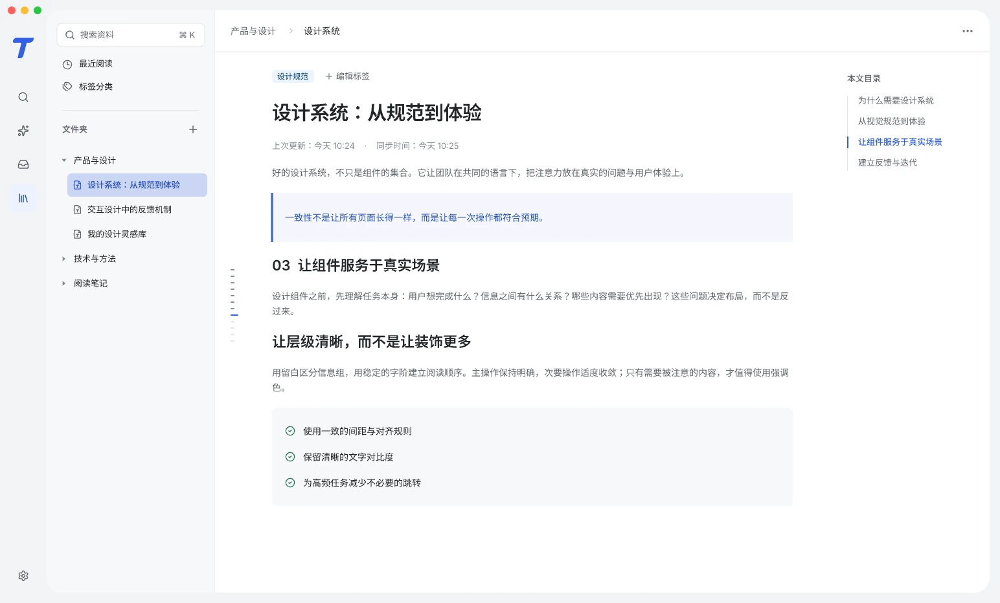

# Tiker

**让值得收藏的链接找得到，让想学的知识有路径。**

Tiker 是一款本地资料管理与 AI 学习桌面应用：遇见好内容，交给「收藏」整理用途、目录和标签；遇见新知识，交给「探知」搜集资料、梳理核心概念、解释重难点，再把学习成果归档到自己的资料库。

[收藏：让链接可复用](#收藏让每一次保存都更容易再次找到) · [探知：从好奇到学懂](#探知把一个学习目标变成可阅读可实践的材料) · [使用指南](docs/getting-started.md) · [下载与版本](#版本与下载) · [开发指南](CONTRIBUTING.md) · [反馈问题](https://github.com/ramiro-qq/tiker-app/issues)



> 本页图片从 Pencil 设计稿导出，用于说明功能与交互，包含示例内容，不是实机运行截图。部分画板保留历史布局、文案和示例耗时，当前实现以应用为准；模型名称已替换为示例，图中时间不代表性能承诺。[图片来源与说明](docs/images/README.md)

## 为什么做 Tiker

收藏夹越来越长，需要时却想不起名字；学习一个新概念，打开十几个标签页，仍不知道先看什么、哪里最难。Tiker 希望减少这些反复整理和查找的工作，让资料从“存下来”走向“找得到、看得懂、用得上”。

| 你的困扰 | Tiker 的做法 |
| --- | --- |
| 链接存了很多，过段时间忘记用途 | AI 整理清晰标题与简短用途简介，保留原链接 |
| 手动分类耗时，目录越建越碎 | 结合页面主题、实际用途和已有目录建议分类，补充关键词标签 |
| 想学一个主题，却不知道从哪里开始 | 说明目标和基础，由探知检索、筛选并组织渐进式学习材料 |
| 概念看过了，难点没理解，也不会应用 | 材料围绕核心概念、易混点、适用场景、案例和自测展开 |
| 链接、学习对话和笔记散落各处 | 在同一桌面空间完成搜索、收藏、探知与文档归档 |

## 收藏：让每一次保存都更容易再次找到

**收藏时少做整理，需要时多一点线索。** 面对技术文档、开源项目、产品工具和长文章，Tiker 不只记住网址，还用 AI 帮你回答：“它是什么？有什么用？放在哪里合适？”



### AI 帮你整理，你保留决定权

- **从标题到用途**：基于网页标题、描述、关键词与必要的短摘录，生成清晰标题和 1–50 字的用途简介。再次看到时，更容易判断为什么值得打开。
- **按语义建议目录**：结合主题与用途，建议最多三级的「领域 / 用途 / 功能类别」路径，优先复用合适的已有目录。教程、工具和项目源码分别判断，避免仅因都在 GitHub 就按同一种用途归类。
- **用标签补足不同线索**：自动建议 1–3 个关键词；主要目录负责归属，标签补充技术、特征与其他用途，避免为每个链接建立专属文件夹。
- **先检查，再确认收藏**：AI 结果可以编辑。你能修改标题、简介、目录和标签，也能自行添加路径；确认前保留草稿，取消不会创建新目录。



### 从浏览到整理，连成一条流程

浏览网页 → Chrome / Edge 扩展或右键唤起 Tiker → 后台整理 → 核对结果 → 确认收藏 → 按目录、标签或关键词再次找到。

任务支持待确认、失败等状态筛选，离开任务页仍可继续处理；失败可重试，也能手动补充后收藏。手动入口与扩展共用去重校验，避免同一网页被反复加入；失败或取消后仍允许重试。已有收藏还可批量校正简介，单条失败保留原内容。



**例如，正在调研前端工具：**把图形引擎文档、文档站框架源码和 AI 教程加入收藏，AI 会依据各自用途建议目录与标签。下次搭建文档站时，你可以沿着“文档框架”目录和相关标签回找，而不用重新猜测链接标题。这里展示的是使用方式，具体分类仍需核对模型建议。

收藏目前整理的是**链接元信息**，不是网页全文离线存档：它不保存新网页的完整正文，也不保证来源网页永久可用。详细操作、AI 输入范围与存储边界见 [剪藏指南](docs/clip-tasks.md)。

## 探知：把一个学习目标变成可阅读、可实践的材料

**说出想学什么，先建立理解的路径，再深入每一个知识点。** 你可以直接描述主题、已有基础和困惑，也可以提供一篇文章或文档链接，让探知围绕指定资料提炼学习内容。



### 帮你省下搜集与组织资料的准备工作

1. **先聚焦目标**：识别学习主题与深度。目标不清晰或链接包含多个主题时，先澄清，不擅自选择方向。
2. **检索并筛选来源**：围绕主题读取资料，优先官方与原始技术文档，以案例和常见问题补充；根据正文相关性筛选，排除无关页面与重复内容。
3. **安排阅读顺序**：结合已有基础，从前置知识到核心概念，再到实践应用，标出必学、选学及可以暂缓的内容，让时间有限时也知道先抓什么。
4. **生成学习材料**：默认组织为一份连贯指南，主题需要时再拆成多份有顺序的文档。可边阅读已生成内容，边等待后续材料完成。
5. **追问并归档**：针对不懂的部分继续问，打开材料预览，核对内容后确认标题与位置，归档为 Markdown，纳入自己的文档资料库。

### 一份材料，应当让你带走什么

| 内容 | 帮助你解决的问题 |
| --- | --- |
| 学习目标与前置知识 | 学完能做什么？需要先懂哪些基础？ |
| 核心概念与工作原理 | 术语是什么意思？为什么这样设计？怎样运作？ |
| 重难点、易混概念与常见误区 | 哪些最值得花时间？容易在哪一步理解错？ |
| 使用场景与适用边界 | 什么情况下适合用？哪些情况不适合？ |
| 贯穿案例与实践步骤 | 如何把零散知识串成一次完整应用？预期结果与排错思路是什么？ |
| 自测、重点总结与参考来源 | 是否真的理解？接下来复习什么？去哪里核对原文？ |

这些是探知组织材料的目标，具体内容取决于主题、来源质量和所选模型。指定链接时，核心材料围绕实际读到的正文提炼；资料不足、无法读取或结论尚未核验时会披露局限，不把模型补充当作已验证事实。

### 从“看懂概念”走到“知道怎么用”



下面这些问题可以直接作为学习起点；示例说明提问方式，不代表预先生成的固定课程或已完成的项目：

| 你可以这样问 | 重点学习路径 |
| --- | --- |
| “我有一点编程基础，想理解 RAG，请结合企业知识库讲解。” | 文档切块、Embedding、检索与生成如何衔接；召回与引用的难点；用最小问答流程理解全链路 |
| “MCP 如何连接 AI 与工具？请用一个调用场景讲清楚。” | 各角色职责、协议交互与工具调用过程；容易混淆的边界；通过示例建立整体认识 |
| “我理解上下文窗口，但不清楚 Agent 的记忆应该怎么设计。” | 上下文、历史与记忆的关系；信息筛选和持久化取舍；结合场景理解适用条件 |
| “请根据这篇文章提取重要概念、难点与案例，按入门顺序解释：〈文章链接〉。” | 围绕指定来源提炼知识，解释术语与原文方法，保留引用，并指出资料未覆盖的部分 |

执行过程中可以查看学习步骤、来源与进度；追问支持排队，也能停止当前轮次。探知使用你在设置中配置的自定义模型，输入框底部可直接切换。它帮助搜集、解释和组织知识；生成内容仍需结合引用与实践自行判断。[了解探知的材料组织方式](docs/learning/progressive-learning-design.md)

## 文档与搜索：让学习成果留下来

收藏帮你保留入口，探知帮你梳理知识，文档承接自己的笔记与归档材料。你可以在本地资料库编辑 Markdown、管理目录与标签、使用表格和文件预览，再通过搜索找回相关内容。



PDF、图片、文本、Markdown、CSV/TSV 等支持范围见 [文件预览](docs/file-preview.md)。需要跨设备时，可连接自己的 GitHub 仓库，预览后启用内容同步；同步范围、冲突与恢复见 [同步指南](docs/github-content-sync.md)。

## 版本与下载

当前源码版本：**0.1.0**，首个开发版本。浏览器剪藏扩展独立版本为 **1.0.5**。

安装包以 [GitHub Releases](https://github.com/ramiro-qq/tiker-app/releases) 的实际附件为准。源码版本不表示已有公开安装包，也不表示已签名、公证或完成所有平台验收。

| 平台 | 计划发行格式 | 当前边界 |
| --- | --- | --- |
| macOS Apple Silicon / Intel | DMG、App | 支持本地构建；正式签名、公证及两种架构验收待发行时记录 |
| Windows x64 | NSIS、MSI | 提供构建流程，尚未在本次任务中验证 |
| Linux x64 | AppImage、deb | 提供构建流程，尚未在本次任务中验证 |

应用尚未集成自动更新。升级前请按 [存储布局](docs/storage-layout.md) 备份资料库及本机配置，下载新版本手动安装。保留应用标识 `com.ai.reader.desktop`，避免升级后丢失已有目录关联。

## 本地开发

技术栈：Tauri 2、React 19、TypeScript 与 Rust。[文档索引](docs/README.md) · [更新记录](CHANGELOG.md) · [版本发布](docs/releasing.md)

准备 Node.js **22.18+**（建议 Node 24 LTS）、npm、Rust stable，以及对应平台的 [Tauri 2 系统依赖](https://v2.tauri.app/start/prerequisites/)。Linux 还需 Secret Service / DBus 开发依赖，旧 GitHub Token 迁移仍使用系统凭据库。

```sh
npm ci
npm run tauri dev
```

仅预览前端：`npm run dev`。浏览器预览无法替代桌面文件授权、模型请求、协议唤起与真实同步验收。开发及构建前会自动从 `src/assets/brand-mark.svg` 生成应用/扩展图标，打包剪藏插件，并复制版本匹配的离线预览资源。

```sh
npm run check:version
npm run check:focus-styles
npm run build
cargo test --locked --manifest-path src-tauri/Cargo.toml --lib
npm run tauri build
```

完整开发流程、测试分组和目录结构见 [CONTRIBUTING.md](CONTRIBUTING.md)。

## 模型与隐私

在「设置 → 模型配置」添加模型并测试连接。支持 OpenAI、DeepSeek、通义千问、Ollama 和自定义 OpenAI 兼容接口；Ollama 可以不填密钥。探知只选择 `provider: custom` 的可用模型，首次进入默认选中列表中的第一个；剪藏使用设置中的默认模型。真实模型名由用户配置，不预置演示密钥。

模型配置和 API Key 保存在本机 `model.json`；GitHub Token、账号及仓库选择保存在本机 `sync-config.json`。这些文件**明文存储、仅限本机**，Unix 写入权限为 `0600`，不随内容同步上传。模型不再访问钥匙串；旧模型缺少密钥时需在设置中重新填写。GitHub 旧 Token 的兼容迁移边界见 [授权说明](docs/github-authorization.md)。

AI 操作会把相关问题、网页或资料内容发送给选定的服务商；GitHub 同步会上传所选资料库的业务内容与附件。正文可能包含隐私，请确认目标服务与仓库权限。[隐私说明](docs/privacy.md) · [存储与备份](docs/storage-layout.md) · [安全报告](SECURITY.md)

GitHub 授权使用源码内置的公开 OAuth Client ID，开发者可以通过 `GITHUB_CLIENT_ID` 环境变量覆盖。Client ID 不是密钥；不要提供 Client Secret。应用不自动加载 `.env`。详情见 [GitHub 授权](docs/github-authorization.md)。

## 贡献与许可

请先阅读 [贡献指南](CONTRIBUTING.md)，提供复现步骤、版本、平台和经过脱敏的日志。不要在 Issue、PR 或截图中上传密钥、私人文档或账号信息。

本仓库尚未指定项目级开源许可证；公开源码不等于授予任意再分发许可。第三方依赖和字体遵循各自许可，见 [第三方说明](THIRD-PARTY-NOTICES.md)。文档结构参考 [hongguo-drama](https://github.com/jackotom/hongguo-drama) 的版本、平台与验证边界组织方式，未复制其应用代码或采用其项目许可证。
