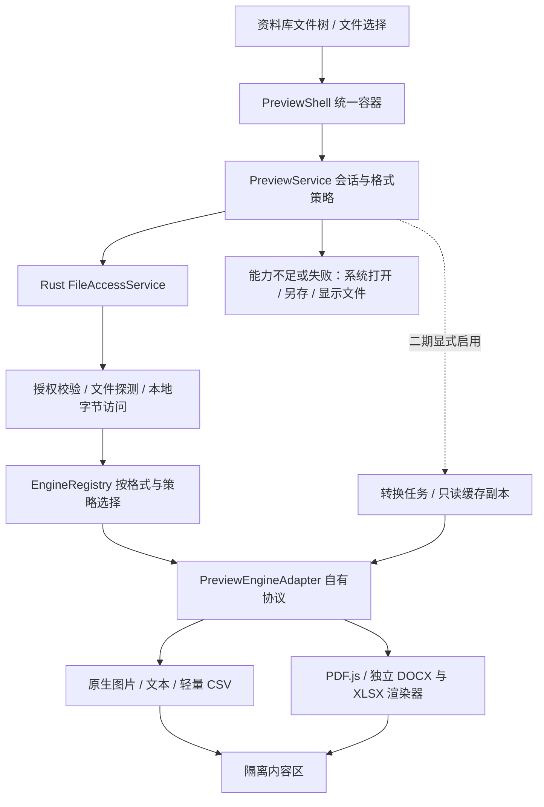

# Tiker 文件预览技术调研与设计

调研日期：2026-11-13。确认日期：2026-11-13。状态：用户已确认架构与分期范围，作为后续实现依据；首批格式已实施，使用方式与验证限制见 [实施说明](file-preview.md)；尚未完成三平台原生兼容性与全面性能验收。

已确认约束：

- 首批格式：PDF、常见图片、文本/Markdown、CSV/TSV；DOCX、XLSX 在后续通过体积、性能与质量验证后纳入。
- 优先控制启动耗时、解析峰值内存及最终安装包体积；第 10 节数值为待实测校准的初始工程预算。
- 业务仅依赖 Tiker 自有预览协议，通过适配层接入引擎，不与 Open File Viewer 或其他第三方方案强耦合。
- 默认每种格式只交付一个实现，未启用引擎从构建入口排除；替换引擎不要求迁移资料数据。

## 1. 建议与边界

采用 **Tiker 自有预览容器 + 引擎无关的预览协议与适配层 + Rust 本地文件访问服务**。按用户补充要求，优先级调整为：常用格式可用、启动与阅读性能稳定、安装体积可控、引擎可替换。首批仅 PDF、常见图片、文本/Markdown、CSV/TSV；DOCX、XLSX 作为下一批，分别通过体积与性能门槛后交付。

Open File Viewer（下文 OFV）作为参考与备选，不默认引入全量 core/react。PDF 首选直接使用 PDF.js；图片使用 WebView 原生图像能力；文本使用原生 DOM；Markdown 只引入轻量解析和净化；CSV/TSV 使用支持引号、转义和换行的轻量解析器。DOCX、XLSX 各选一个解析器，禁止为一个格式重复引入多套引擎。所有第三方库的版本与具体选择在 PoC 中确定。

首期以只读预览为目标，不提供 Office 编辑、公式重算、宏执行、批注回写、CAD 专业操作或任意网页执行。笔记编辑器与附件预览分离。不能预览的文件展示真实原因，并提供“使用系统应用打开”“另存原文件”“在文件夹中显示”。不把预览副本当原文件保存。

## 2. 文章与上游核查

已通过浏览器读取原文《支持 110 种文件预览！兼容 Vue、React、Svelte！》。文章的核心价值是统一容器、插件协议、工具栏和 fallback；“110 种”是格式覆盖口径，不能直接作为高保真能力或产品验收承诺。[原文](https://mp.weixin.qq.com/s/YjJnEe0Yx5d2_t8Q34MoIA)

核查对象：上游 main 提交 `08d135f6e9f45fcfd6337be67b52eb271eab2841`；npm 注册表查询到 core/react 的 latest 均为 `1.0.0`。**main 源码与已发布 npm 包不能默认视为一致**；下述源码发现须在安装的锁定包上复验。

| 核查点 | 证据与含义 | 对 Tiker 的决策 |
| --- | --- | --- |
| 开源及框架 | 主项目 MIT；React 包 peer 要求 React/React DOM >=18 | 当前 React 19 满足声明范围，运行兼容性仍需实测；附带依赖逐项检查许可证 |
| 输入与扩展 | `PreviewSource` 支持 File、Blob、URL 字符串、ArrayBuffer；插件有 match/render，实例有 destroy | 支持本地访问抽象；Tiker 自有文件模型通过 adapter 转换 |
| PDF | 使用 PDF.js，提供 Worker、CMap、标准字库、WASM 路径选项；默认部分资源为 jsDelivr | 所有运行资源随应用打包；不能只本地化主 JS |
| Office | DOCX 使用 docx-preview；表格依赖中 `xlsx` 实际别名为 `@stackline/xlsx`；支持 convert/convertRemote 回调 | 不声称等同完整 Office；检查实际解析依赖及样本，不盲目重复安装另一套表格库 |
| 转换 | Office 暴露转换回调，调用方提供结果 | 这是扩展点，不代表内置可部署转换服务 |
| 包体积 | npm core 自身解包约 7.38 MB，依赖中包含多类解析器 | 此数字不含全部依赖，也不是最终 bundle 或安装包大小；须记录 Vite 产物和安装包增量 |
| 加载入口 | 已核查 main 的 core/lite：导出容器、检测、图片、PDF、fallback 和类型，没有 Office 插件 | 仅作为 PDF/图片候选对照；不能用 lite 实现全部首期格式，也不能把入口轻量等同于最终包轻量 |
| React 生命周期 | adapter 的 effect 依赖 file、plugins、toolbar、回调等引用 | 保持对象和回调稳定，避免 UI 重渲染导致文档重载 |

源码依据：[类型协议](https://github.com/xushanpei/open-file-viewer/blob/08d135f6e9f45fcfd6337be67b52eb271eab2841/packages/core/src/types.ts)、[PDF 插件](https://github.com/xushanpei/open-file-viewer/blob/08d135f6e9f45fcfd6337be67b52eb271eab2841/packages/core/src/plugins/pdf.ts)、[Office 插件](https://github.com/xushanpei/open-file-viewer/blob/08d135f6e9f45fcfd6337be67b52eb271eab2841/packages/core/src/plugins/office.ts)、[core 依赖](https://github.com/xushanpei/open-file-viewer/blob/08d135f6e9f45fcfd6337be67b52eb271eab2841/packages/core/package.json)、[React adapter](https://github.com/xushanpei/open-file-viewer/blob/08d135f6e9f45fcfd6337be67b52eb271eab2841/packages/react/src/index.tsx)。发布信息：[core registry](https://registry.npmjs.org/@open-file-viewer/core/latest)、[React registry](https://registry.npmjs.org/@open-file-viewer/react/latest)。

## 3. 当前项目差距

- `src/App.tsx` 通过 ReaderState 切换硬编码附件名称，没有传递真实文件标识。
- `src/features/Reader.tsx` 的 PDF、图片和表格都是示意内容；页数写死为 24，表格只在内存修改。
- `src/services` 尚无文件访问、格式识别与预览服务；Rust 已有 workspace 配置，可用于授权资料库根目录。
- `src-tauri/tauri.conf.json` 当前 `csp: null`，不能直接把不可信文档 HTML 放入带 IPC 能力的应用 DOM。
- GitHub 文件同步未接通。预览应先服务本地资料库，远程附件以后经独立下载层接入。
- 剪藏记录目前只保存链接与收藏元信息，文件预览不应暗中改成保存网页正文。

## 4. 候选方案比较

| 方案 | 适合程度 | 成本与限制 |
| --- | --- | --- |
| OFV + 自有适配层 | 参考和备选；仅在与独立渲染器对比通过预算后采用 | 不能因插件多而默认接入；实际产物必须证明无无关格式依赖 |
| 少量独立渲染器 + 自有协议 | 当前首选，逐格式控制包体积和资源占用 | 需要自行处理生命周期、工具栏和一致的错误状态；首期保持最小接口 |
| Office 转 PDF，再统一阅读 | 二期可选，适合版式阅读需求 | 需要转换进程或服务，带来安装体积、字体、资源隔离及维护成本 |
| 在线第三方 Office Viewer | 不作为默认路线 | 本地私有文件可达性、联网和数据传输条件与离线资料库不匹配 |

转换引擎尚未选型，不把部署某个重型服务列为首期前置条件。若明确要求复杂 PPT/Word 版式保真，应提前安排转换引擎专项验证，前端插件不能独立承担这项承诺。

## 5. 产品支持矩阵

以下是拟定产品范围，不是声称已测试通过的 OFV 能力。支持等级：正式支持、基础预览、仅外部打开。

| 阶段 | 文件 | 目标体验 | 明确限制 |
| --- | --- | --- | --- |
| P1 正式支持 | PDF | 真实页数、跳页、缩放、文本选择、按需渲染 | 加密文件先给外部打开入口；扫描 PDF 不承诺搜索；不执行文档脚本 |
| P1 正式支持 | PNG/JPEG/GIF/WebP | 缩放、旋转、适合窗口、实际尺寸 | 设置解码像素上限；SVG 先转安全图像或独立隔离，不直接内联 |
| P1a 正式支持 | TXT/MD/JSON/常见代码 | 换行、复制、查找、编码提示；高亮后置 | HTML/XML 默认按源码展示；Markdown 原生 HTML 禁用或严格净化 |
| P1b 预算通过后 | DOCX | 正文、图片、常规表格 | 页眉页脚、字体、复杂浮动布局需样本验证；不承诺完全还原 |
| P1b 预算通过后 | XLSX | 工作表切换、单元格值、合并区域、行列窗口 | 不重算公式，不执行宏及外部连接；无公式缓存时显示说明 |
| 后续按需求 | PPTX、DOC/XLS/PPT 等旧格式 | 样本通过后提供基础阅读，或展示转换副本 | 不承诺动画、音视频、SmartArt、旧二进制格式完整还原 |
| P2 按平台支持 | MP4/WebM、MP3/WAV 等 | 播放、暂停、进度 | 容器扩展名不等于编解码器支持；按系统 WebView 实测结果展示能力 |
| P2 基础预览 | ZIP、EPUB、EML | 目录/章节/正文 | 先限 ZIP；RAR/7z 不随意承诺；邮件不加载远程图片 |
| P3 专项 | CAD/3D/GIS/PSD/SQLite 等 | 根据真实资料需求逐项引入 | 不为格式数量一次性引入全部依赖；默认外部打开 |

CSV/TSV 在 P1a 以只读表格展示，独立解析，不借用 XLSX 引擎；不能按逗号直接 split，必须正确处理引号内分隔符和跨行字段。

PDF 全文搜索、缩略图、打印列为按引擎能力启用的功能：必须单独验收，不能用“有 PDF 渲染”代替。表格不出现编辑工具栏和保存提示，避免现有示例界面误导用户。

## 6. 模块与数据流



业务元信息、收藏和标签留在宿主 React 界面；解析得到的 HTML 在受限内容区中展示。插件只负责渲染，不读取钥匙串、模型配置或 GitHub token。预览不触发模型调用或文件上传。

### 6.1 自有模型与服务契约

建议接口如下，均为拟新增，不是现有 API：

```ts
type PreviewInput =
  | { kind: 'workspace'; workspaceId: string; relativePath: string }
  | { kind: 'picked'; grantId: string };

interface PreviewDescriptor {
  sessionId: string;
  fileId: string;
  name: string;
  size: number;
  detectedMime: string;
  extension: string;
  revision: string;
  fidelity: 'full' | 'basic' | 'external-only';
  delivery: { kind: 'url'; url: string } | { kind: 'bounded-text'; text: string };
  warnings: string[];
}

```

`fidelity` 是本产品对已验收样本范围的等级，不是对任意文件的完美还原保证；具体工具栏能力以运行时检测为准。

文件 descriptor 不携带第三方插件对象、引擎配置或 renderer 字段。Rust 负责授权与描述文件，具体引擎由前端 registry 选择；文件类型识别结果不会因更换引擎而改变。当前支持等级由 PreviewService 合并格式策略与适配器运行结果得出，Rust 的预判不代替渲染质量判断。

Rust 命令拟新增：

- `list_workspace_files(workspaceId, relativeDir, cursor)`：分页列真实文件，供文件树使用。
- `open_preview(input)`：授权、探测文件、检查限额、创建会话，返回 descriptor。
- `close_preview(sessionId)`：撤销会话，清理文件句柄和临时资源。
- `save_original_as(sessionId)` / `open_original(sessionId)` / `reveal_original(sessionId)`：原文件操作由 Rust 执行，目的路径通过系统对话框获得。
- `get_preview_position(fileId, revision)` / `save_preview_position(...)`：保存页码、缩放、工作表等阅读位置。

文件树初期不依赖完整搜索索引。workspaceId/grantId 均由 Rust 生成并查表，不能由前端传入任意系统绝对路径代替。文件扩展名、MIME 和 magic bytes 综合判定，冲突时走保守路径；ZIP 容器还需辨别 DOCX/XLSX/PPTX，不能仅凭 ZIP 头判类型。

### 6.2 本地字节传输

小文本走有大小上限的命令返回；二进制走只读会话 URL，不通过 JSON 数字数组或 Base64 传整个文件。图片/媒体/PDF 可消费 URL；Office 插件通常仍需要完整 ArrayBuffer，因此 URL 不能消除其内存开销。

首选实现自定义只读协议；若目标 WebView 对 Range/CORS 行为不满足验收，再选择仅绑定 loopback 的资源服务。两者均须支持：

- URL 只包含不可猜测、短期有效的会话标识，不暴露任意路径；校验请求来源和有效会话。
- GET/HEAD、正确 Content-Type、长度、单段 Range、206/416 和取消读取；先验证 PDF seek 和媒体拖动。
- 协议访问逻辑独立执行目录授权和句柄校验，不能认为 Tauri IPC capability 自动保护所有自定义资源请求。
- 不注册文件写入路由，不监听外网地址；开发/生产 origin 分别配置。
- 关闭或换文件时撤销会话，已有读取取消；避免长时间占用文件导致系统无法重命名或删除。

允许先用受限 Blob 路线验证小文件，但上线大 PDF/视频前必须补齐流式访问验证。Range 只优化可利用它的引擎，不承诺所有格式随机读取。

### 6.3 生命周期与状态

状态流：`idle → authorizing → probing → loading → ready`；分支包括 `blocked / unsupported / failed / cancelled`；二期增加 `converting`。

每次打开分配 sessionId 和递增 generation。切换文件后取消旧任务，迟到结果只有 generation 与 sessionId 都匹配才可更新界面。卸载时调用引擎 destroy、revokeObjectURL、销毁 Worker、清除监听和撤销 Rust 会话。React StrictMode 的挂载/卸载重入必须无资源泄漏。

元数据未就绪时不展示假页数或示例内容。错误细分文件不存在、无权限、损坏、加密、超限、编码不明、编解码器不支持和引擎异常；只有可恢复错误显示重试。

### 6.4 引擎适配层：强制边界

依赖方向固定为：`Reader / PreviewShell → PreviewService → 自有 contracts ← 各引擎 adapter`。Registry 只保存引擎元信息与延迟加载函数。Open File Viewer、PDF.js、未来转换或原生预览方案都是该协议的实现，不是业务层基类。

职责划分：

| 模块 | 负责 | 不承载 |
| --- | --- | --- |
| PreviewShell / Toolbar | 文件信息、统一布局、按钮、错误和加载状态 | 第三方组件 props、插件名判断、解析库调用 |
| PreviewService | 选择引擎、会话、取消、错误归一、阅读状态恢复 | 文档解析实现 |
| EngineRegistry | 格式匹配、优先级、平台条件、load 工厂 | 静态 import 所有引擎、内容解析 |
| EngineAdapter | 字节来源转换、第三方配置、能力映射、命令和清理 | 任意路径读取、保存原文件、收藏标签等业务 |
| Rust FileAccessService | 文件授权、读取、另存、系统打开与资源撤销 | 特定前端预览 SDK 的接口 |

自有协议草案如下；类型名称、命令和事件均由 Tiker 定义，不复制某个 SDK 的 API。业务不依赖 OFV 的 PreviewOptions/PreviewPlugin/FileViewer，也不依赖 PDF.js 的 document/page 对象。

```ts
type PreviewAction = 'zoom' | 'rotate' | 'page' | 'search' | 'print' | 'sheet';
type PreviewCommand =
  | { type: 'zoom'; scale: number } // 1 = 100%
  | { type: 'rotate'; degrees: 0 | 90 | 180 | 270 }
  | { type: 'page'; page: number } // 从 1 开始
  | { type: 'search'; query: string }
  | { type: 'print' }
  | { type: 'sheet'; index: number }; // 从 0 开始

interface PreviewPosition {
  version: 1;
  page?: number;
  scale?: number;
  rotation?: 0 | 90 | 180 | 270;
  sheetIndex?: number;
  scrollRatio?: number;
}

interface PreviewFailure {
  code: 'unsupported' | 'encrypted' | 'corrupt' | 'limit'
    | 'access' | 'cancelled' | 'engine';
  message: string;
  recoverable: boolean;
}

type PreviewEvent =
  | { type: 'capabilities'; actions: PreviewAction[] }
  | { type: 'position'; position: PreviewPosition }
  | { type: 'metadata'; pageCount?: number; sheetNames?: string[] }
  | { type: 'warning'; message: string }
  | { type: 'error'; error: PreviewFailure };

interface PreviewHost {
  element: HTMLElement;
  file: PreviewDescriptor;
  signal: AbortSignal;
  theme: 'light' | 'dark';
  emit(event: PreviewEvent): void;
}

interface PreviewEngineAdapter {
  // 成功表示首屏可读；失败抛出错误，由 service 归一。
  mount(host: PreviewHost): Promise<{ actions: PreviewAction[] }>;
  execute(command: PreviewCommand): Promise<'applied' | 'unsupported'>;
  restore(position: PreviewPosition): Promise<void>;
  resize(width: number, height: number): void;
  setTheme(theme: 'light' | 'dark'): void;
  // 必须幂等；负责中止未完成 mount，并等待所持资源释放。
  dispose(): Promise<void>;
}

interface PreviewEngineRegistration {
  id: string; // 仅 registry、诊断和适配器测试使用
  priority: number;
  // 只依据文件元数据和平台判断，不触发重型解析。
  matches(file: PreviewDescriptor, platform: string): boolean;
  load(): Promise<() => PreviewEngineAdapter>; // 每个会话创建独立实例
}
```

上方 `destroy` 表示第三方清理动作，统一协议实际使用可等待的 `dispose`。适配器内部可调用 SDK 的 destroy/terminate，不能让调用方知道其差异。未完成 mount 时收到 dispose 也必须清理部分资源；库本身不支持取消时，以隔离 Worker/WebView 终止和 generation 丢弃迟到结果补齐。

协议只抽象已经需要的交集，不提前建设万能插件平台。字体、Worker 路径、PDF 参数、OFV 工具栏选项等放在各 adapter 私有配置中，不用 `Record<string, unknown>` 透传到业务层。需要新增交互时先扩展自有命令并补协议测试。

### 6.5 切换引擎与能力降级

1. Service 根据 registry 的元信息选择实现，延迟加载唯一候选，创建实例并 mount；UI 不按 engineId 写条件分支。
2. 能力由当前文件实际返回，工具栏据此显示或禁用按钮。只有服务端图片式预览的候选可只提供缩放，无需伪造搜索、文本选择或分页能力。
3. 解析错误在 adapter 内映射为自有错误；用户提示不暴露 SDK 堆栈。诊断可记录引擎及版本，不记录敏感正文与授权 URL。
4. 仅对“当前引擎不支持”或确认的引擎异常，允许尝试最多一个显式配置的备用引擎；无权限、超限、加密及取消不自动换引擎规避策略。失败后释放旧实例并再次核对会话，再进入备选；不循环重试，不自动上传转换。
5. 阅读位置只保存上述自有字段与文件 revision，不持久化第三方实例或专有 state。不同引擎的 Office 分页可能不同，恢复做 best effort，失效字段忽略并夹紧范围。
6. 替换时改 registry 的注册与 adapter，原文件、标签、收藏、文件服务及 PreviewShell 保持自有协议。引擎切换不要求用户迁移资料数据。

服务型引擎未来可以实现相同协议，但联网传输、转换授权和异步任务仍由独立 service 管理，不能藏在 adapter 中静默发生。

**可替换性不意味着同时打包多套引擎。** 默认每种格式只交付一个实现，registry 由构建清单生成，未启用的 adapter 及第三方包不被构建图引用；不能仅靠运行时配置禁用，因为 dynamic import 仍会生成待分发 chunk。备用引擎只有在确有需要且总预算通过时才随包交付。首期不建设远程插件下载系统。

适配层验收：使用 mock adapter 验证 Shell 无 SDK 依赖；统一跑成功、失败、取消、重复释放、能力更新、位置恢复和迟到事件用例；替换同格式 adapter 后业务页面与原文件服务不需要改动；生产构建确认只有启用的引擎产物。第一期 mock 与真实 adapter 即可检验边界，无需为测试额外打包另一套重型引擎。

## 7. 阅读交互

文件树单击进入现有 Reader 主区域；保留文件树上下文。顶部统一显示名称、类型、大小、支持等级，以及按能力启用的查找、全屏、另存原文件、系统打开和更多操作。附件不展示“编辑”“已保存”等笔记状态。

PDF 提供页码输入、缩放与适合宽度；图片提供旋转和适合窗口；表格提供工作表列表、行列定位和只读提示。缩略图、打印、搜索只有验收通过时才出现。

统一处理加载骨架、失败说明、超限说明和不支持页面，保留返回操作；禁止错误后悄悄打开浏览器。桌面上的“下载”统一改为“另存原文件”，避免浏览器下载语义与本地文件混淆。

阅读位置按 workspaceId + fileId + revision 保存。普通状态恢复放在缩放/工作表就绪后；源文件改变则重新探测，失效页码做范围校正。二期可补目录监控，首期在重新打开时校验元数据。

## 8. 安全、离线和资源预算

这是不可信文件解析与本地权限结合的必要设计约束：

1. 资料库路径 canonicalize 后校验边界，拒绝 `..`、越界符号链接、设备文件和命名管道；尽量在打开句柄时检查并复用，防止校验后替换文件。任意路径不能直接流入 opener。
2. 收紧当前空 CSP。结合 Vite 和 Tauri 实际运行源配置 script/worker/connect/img/font/media/frame 指令；不直接照抄宽泛 `*`。PDF Worker、CMap、标准字库和 WASM 全部随应用发布，版本一致；关闭 PDF 的脚本型 web fallback，具体配置须在锁定 npm 包中复验。
3. 文本用 textContent；HTML 默认源码；Markdown/Office/邮件 HTML 净化，过滤脚本、事件、表单、危险 URL 和外链资源。内容区使用独立 origin 的 sandbox iframe 或无 IPC 权限独立 WebView；不把 allow-scripts 与可恢复宿主同源权限一起开放。不应假设 DOMPurify 单独构成完整隔离。
4. 高风险解析放 Worker 或独立预览 WebView；宿主 watchdog 可终止 Worker/销毁 WebView。Promise 超时不能中断主线程同步解析，单纯加 setTimeout 不足以防卡死。OFV 某插件若不能满足隔离要求，替换或降级，不能只关闭报错。
5. 所有外链点击经宿主校验，仅用户主动动作允许 http/https；邮件远程图片、文档外部关联默认关闭。不能为改善样式静默下载远程字体。
6. 断网启动并打开未读过样本，抓取网络记录验证无隐藏 CDN 请求。WebView 自带能力与 Chromium 浏览器不同，必须在 WKWebView、WebView2 和目标 Linux WebKitGTK 分别验证；未验平台不列入已支持平台。

初始预算如下，均为待样本调优的产品阈值：

| 资源 | 初始限制 / 行为 |
| --- | --- |
| 文本 | 前 2 MiB 快速预览，完整预览最多 10 MiB，超过则分段或外部打开；截断必须显式标明 |
| Office | 压缩源文件最多 25 MiB；同时限制 ZIP 条目、总解压预算（初值 200 MiB）和压缩比，防止小文件解压膨胀 |
| 表格 | 初始窗口 200 行 × 80 列，按需切换；最大解析单元格预算 100 万；超限提示，不能把窗口外数据假装为空 |
| 图片 | 最大 40 MP 解码像素，超限改缩略图或外部打开 |
| PDF | 暂定源文件 200 MiB，按需渲染；控制活跃 canvas 数量与 DPR，实际内存上限须桌面压测 |
| 并发 | 一个活跃重型解析会话，预加载最多一个轻量元数据任务 |
| 超时 | 10 秒提示耗时，30 秒允许终止并兜底；内部插件超时不能代替独立执行环境 |

后续转换缓存放应用缓存目录，不放入资料库同步目录。缓存键使用源文件内容摘要 + 转换器版本 + 选项 + 字体环境指纹；保存完整性标志，失败临时文件不入库。建议初始 500 MiB LRU 预算，可清理；原文件与用户导出结果不参与淘汰。

## 9. 实施拆分

建议文件结构：

```text
src/features/preview/
  PreviewShell.tsx
  PreviewToolbar.tsx
  PreviewFallback.tsx
  usePreviewSession.ts
  contracts.ts
  engines/buildManifest.ts
  engines/pdfAdapter.ts
  engines/imageAdapter.ts
  engines/textAdapter.ts
  engines/csvAdapter.ts
  engines/registry.ts
src/services/files.ts
src/services/preview.ts
src-tauri/src/file_access.rs
src-tauri/src/file_preview.rs
```

| 阶段 | 交付 | 完成门槛 |
| --- | --- | --- |
| P0 技术验证，估计 1–2 人日 | 独立 PDF.js 路线建立基线，固定精确版本；DOCX/XLSX 分别做体积对照 | 离线运行、生产包资源、目标平台初测；逐项记录体积和内存，未达标的格式后置 |
| P1a 基础能力，估计 3–5 人日 | Rust 文件授权/探测/会话、真实文件树、统一容器、PDF/图片/文本/CSV、外部打开和另存 | 消除静态附件示例；路径越界测试与关闭释放通过 |
| P1b Office 与验收，估计 3–5 人日 | DOCX、XLSX/CSV 只读预览、隔离、阅读状态、失败分类、生产 CSP | 常用样本通过，无编辑假象；换文件不串内容；离线验收通过 |
| 后续独立立项 | PPTX/媒体/ZIP/EPUB/邮件；可选转换与缓存 | 每类格式独立样本验收，再开放开关 |

以上为单名熟悉项目的工程师的粗估，不是承诺工期。三平台正式发布、复杂 Office 保真和转换引擎集成需另估；P0 发现上游需修复时调整排期。

不直接把 OFV 全套 UI 塞入现有 Reader；先把 Reader 分为笔记编辑与附件预览。插件注册按实际类型延迟加载，包分析确认是否真正拆包，不把 dynamic import 等同于依赖已从产物移除。

## 10. 性能与体积优先的交付门槛

本节为 2026-11-13 用户明确要求后的收敛决策。少量核心格式先交付，其他格式没有默认排期。

### 10.1 体积统计口径

必须分别记录，不能相互替代：

- 首屏实际请求的 JS/CSS：决定启动时解析与执行成本；懒加载可降低这一项。
- 完整 `dist`：包含未打开过的延迟 chunk、PDF Worker、CMap、标准字库、WASM、样式和其他静态资源。
- 安装后的 `.app` 或平台等价目录：包含 Rust 二进制、原生库和所有 Web 资源。
- 单个分发安装包（DMG/MSI/AppImage 等）：用同平台、同架构、同构建参数比较增量，不能把多个旧安装包目录的总和当作一个安装包大小。

**懒加载不减少完整安装体积。** 真正减体积依赖于减少格式、去掉未使用依赖与静态资源、避免重复运行时，以及构建结果确认的裁剪。gzip 大小与 node_modules 大小均不能代替最终安装包大小。

初始工程预算（待可复现基线建立后校准，不是实测值）：

| 指标 | P1a 目标 | 超预算处理 |
| --- | --- | --- |
| 首屏入口 JS 增量 | gzip 不超过 30 KiB；首次预览前不加载 PDF/Office 解析器 | 检查入口静态 import、公共 chunk 和预加载 |
| 全部 Web 资源增量 | 不超过 15 MiB，计入所有 PDF 辅助资源 | 核查 Worker 重复版本、字库、source map 和无关文件；不能直接删中文字体映射换体积 |
| 同平台安装目录增量 | 不超过 20 MiB | 明确定位 JS/原生/资源来源，超限先调整依赖 |
| 同平台分发包增量 | 暂定不超过 10 MiB | 以真正生成的单个安装包测量，不用 gzip 模拟代替 |
| DOCX + XLSX 后续增量 | 合计 Web 资源暂定不超过 5 MiB，单独记录各自贡献 | 分别决定是否纳入，不能为一个格式引入整套 Office/3D/GIS 引擎 |

优先保证有价值的格式正确可读，若 PDF 字体与辅助资源导致预算冲突，明确列出实际成本再调整范围或预算，不悄悄破坏离线支持。不捆绑 Chromium、LibreOffice、Java 转换服务或完整 CJK 系统字体；沿用 Tauri 的系统 WebView。

### 10.2 运行性能策略

- 启动阶段仅注册格式元信息，不 import 解析库、不扫描全文、不解析最近文件。文件树分页，预览在用户点开后开始。
- PDF 只保留可见页与邻近页 canvas，初值最多 5 页；单页 canvas 暂定最多 8 MP，按窗口与 DPR 调整。大型扫描 PDF 不能一次渲染全部页面。
- XLSX/CSV 解析放 Worker；读取窗口不代表只解析窗口，必须监测解析阶段峰值。DOCX 的 DOM 渲染不能简单搬到 Worker，应限制文档规模，并通过隔离内容 WebView 避免拖死宿主。
- 文本大文件分段，代码首期不引入整套编辑器或全语言高亮包；JSON 不默认构建超大的展开树。
- 二进制避免 Base64 与 JSON 数组传输；减少 Blob/ArrayBuffer 重复拷贝。只保留一个活跃重型解析任务；切换即取消，离开即释放 Worker、canvas、URL 与句柄。
- 图片读取尺寸后做像素预算判定，超大原图使用受限缩略图路径；虚拟表格只保留视口 DOM。按需加载只解决首次成本，不能替代解析限额和释放。

### 10.3 可复现测量与发布检查

建立无预览依赖的当前成功构建基线，然后每增加一个格式构建一次；保存每个 chunk/静态资源字节数、首屏 gzip、安装目录和分发包大小的 JSON 报告。报告按平台/架构分开，后续自动检查总预算与相对上次发布的增量。

运行基准记录目标机型号/内存/系统与 WebView 版本，冷启动取多次样本；对预览开启前、解析峰值、关闭后分别测量进程组内存，不能只看 JS heap。以同机器无预览版本为对照，启动 p95 回退暂定不得超过 10%；换文件时宿主点击反馈 p95 目标 100 ms 内；30 次开关后内存不持续单调增长。阈值均需真实桌面测试，不把预期当结果。

本轮尝试建立基线：`npm run build` 被现有 `src/features/Library.tsx` 的类型错误阻断，包括局部 document 名称遮蔽和 Reader Props 不匹配，尚未取得最新成功构建。已有旧 `dist` 总计约 404 KB，不含可确认的最新构建结果；旧 bundle 中有多个历史应用产物，不能据此报最终安装包体积。本轮仅修订方案，未处理这些应用代码错误。

## 11. 验收清单与决策门槛

- 正常样本：中英文混排/嵌入字体/扫描 PDF，多页 DOCX，合并单元格/多工作表/公式缓存 XLSX，BOM 与 GB18030 文本，常见图片。
- 异常样本：空文件、假扩展名、截断 ZIP、密码保护 PDF、损坏 Office、超大图片、极大工作表、路径越界、符号链接逃逸、脚本型 SVG/HTML、ZIP 膨胀和远程资源引用。
- 生命周期：连续切换 30 个文件、打开立即关闭、切库时正在读取、同文件重新打开、外部修改源文件、开发 StrictMode 重入；无旧结果覆盖，无残留播放和无限增长资源。
- 离线与权限：断网冷启动；生产 CSP 下全部核心格式可打开；文档脚本无法 invoke，无法访问系统密钥或其他资料库文件。
- 传输：HEAD、普通 GET、合法及越界 Range、会话撤销、媒体 seek、PDF 大文件跳页；源文件关闭后能被系统重命名/删除。
- 性能：在记录明确型号/内存/系统版本的目标设备上，拟定 10 MiB 文本首屏不超过 1 秒、20 MiB PDF 首屏不超过 2 秒、10 MiB DOCX/XLSX 首屏不超过 5 秒；这些是验收目标，未做性能实测。记录 p50/p95、峰值内存、退出后回落和安装包增量。
- 浏览器开发模式：只预览显式选择的 File，或展示清晰的桌面功能提示；不伪造文件树和原文件访问成功。

每种独立渲染器都需同时满足离线、安全、质量和体积门槛。OFV lite 仅作为可选对照，采用前必须证明不会增加不必要的依赖。任何候选超预算或造成明显卡顿时先后置该格式，保留外部打开，不扩大首批范围。测试通过前不发布“支持 110 种格式”的文案。

## 12. 其他依据与调研限制

- [OFV 官方项目](https://github.com/xushanpei/open-file-viewer) 与 [官方站点](https://open-file-viewer-workspace.void.app/)：用于确认定位和文档入口，能力判断优先参考具体源码和样本。
- [PDF.js 官方入门](https://mozilla.github.io/pdf.js/getting_started/)：PDF display/viewer 分层及 Worker、CMap 等资源结构。
- [Tauri capabilities](https://v2.tauri.app/security/capabilities/)：WebView 权限边界；[Tauri CSP](https://v2.tauri.app/security/csp/)：发布时需结合实际资源收紧策略。

本次已完成文章阅读、项目结构检查、上游源码（含 lite 入口）与 npm 元数据核查；未安装 OFV、未执行文档渲染 PoC、未跑三平台兼容性和性能测试，也未修改应用代码。OFV 格式识别范围、实际格式还原能力、所选 npm 包与 main 的差异，需在 P0 通过锁定版本验证。

补充入口依据：[OFV lite 导出](https://github.com/xushanpei/open-file-viewer/blob/08d135f6e9f45fcfd6337be67b52eb271eab2841/packages/core/src/lite.ts)。

实施更新：首批代码已落地，当前不引入 OFV，实际功能、格式边界与后续未完成项以 [文件预览实施说明](file-preview.md) 为准。前文调研阶段的“未实现”“构建阻断”等表述为当时记录，不能视为当前构建结果。
